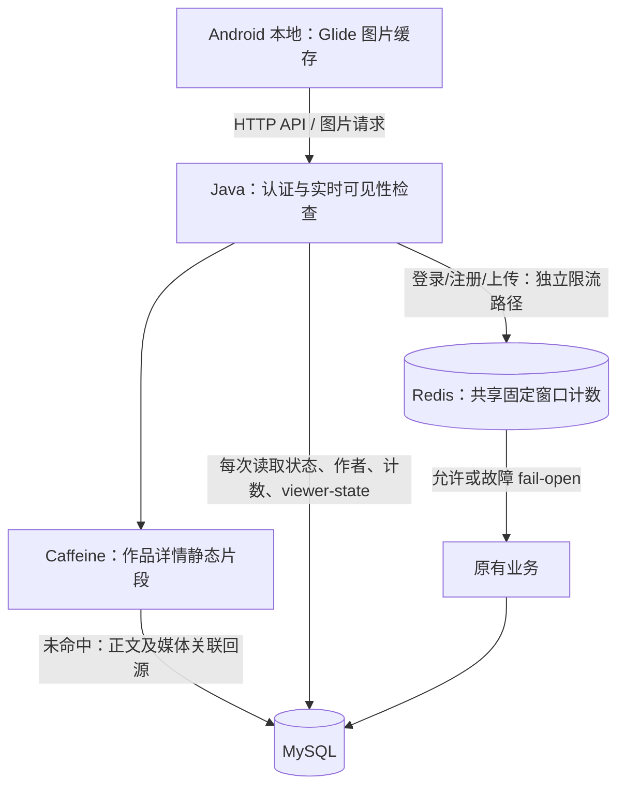
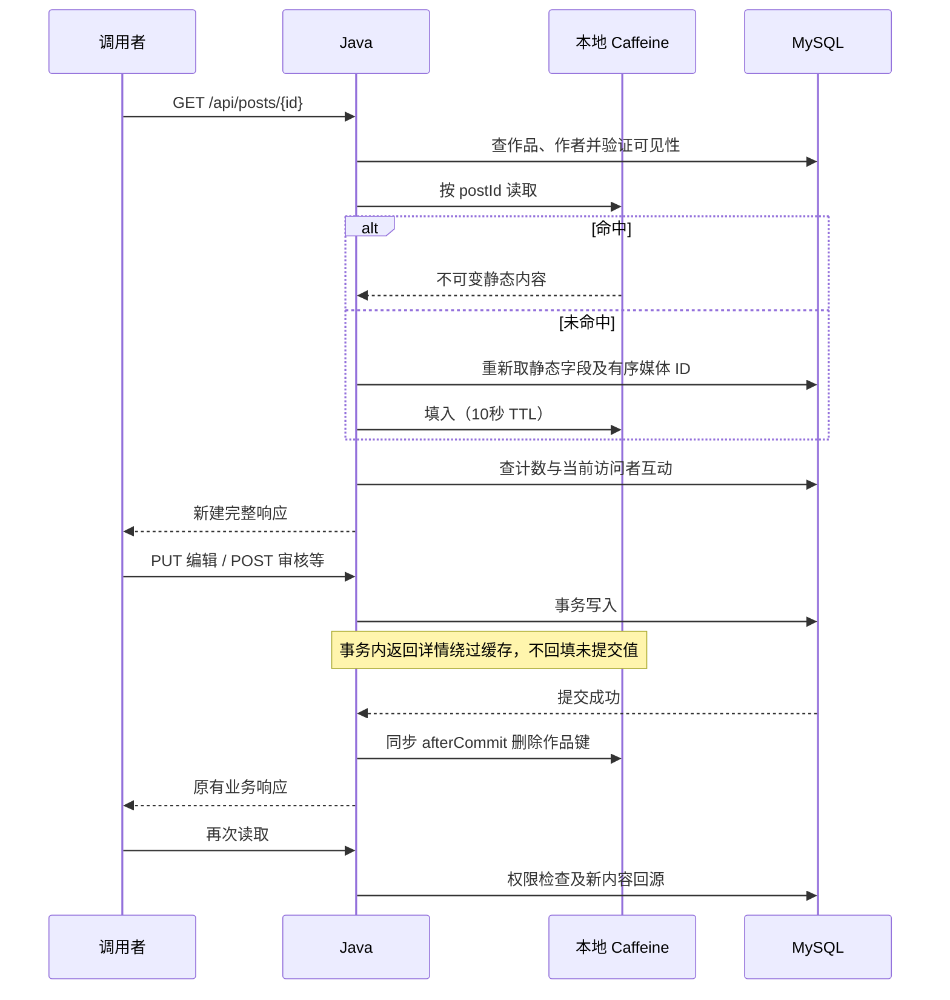

# 缓存设计与工作原理

## 范围与依赖

基于 dev `8972e28`，实现于 `feature/cache-layer`。本地验收针对该基线上的未提交工作区；提交后以 PR 的最终提交号为准。Java 17、Spring Boot 3.5.16 管理 Caffeine 3.2.4、Spring Data Redis 3.5.13 的版本。

本期增加 Caffeine 作品详情静态片段缓存，用原生 API 控制事务旁路和失效，不增加 Spring Cache starter。缓存没有改变 HTTP 契约，也不为 Feed、搜索、收藏、用户资料、会话或画像增加缓存。Redis 继续保存既有短期共享限流计数，不存储作品响应。MySQL 始终是业务事实来源。

## 分层与实际数据路径



这是职责分层，不是 Android → Caffeine → Redis → MySQL 的逐级业务缓存回源链。图片字节仍走原媒体权限检查，不被 Caffeine 缓存；Android Glide 与服务端详情缓存也不互相失效。Redis 不可用时不会尝试把共享额度改存到 Caffeine。

## 键、过期与失效

| 存储 | 键/数据 | 容量、TTL | 失效触发器 |
| --- | --- | --- | --- |
| Caffeine，单 JVM 私有实例 | postId 数字 → 不可变 title/content/clips/有序 media_ids | 最大 1,000 条；写入后 10 秒过期，命中不续期 | 作品创建、编辑、应用创作建议、提交/撤回、管理员审核；点赞/收藏、评论新增（含自动回复）/删除/隐藏/恢复，均提交后删除作品键 |
| Redis 登录 IP | `<namespace>:v1:login-ip:<sha256>` → 次数 | 100 次/60秒 | 首次请求创建窗口，TTL 自动清理 |
| Redis 登录 IP/账号 | `<namespace>:v1:login-account:<sha256>` → 次数 | 10 次/60秒 | 同上；登录成功不清零 |
| Redis 注册 IP | `<namespace>:v1:register-ip:<sha256>` → 次数 | 10 次/600秒 | 同上 |
| Redis 上传用户 | `<namespace>:v1:upload-user:<sha256>` → 次数 | 30 次/60秒 | 同上；先认证再计数 |

Redis 的摘要输入对每段身份使用长度前缀编码，避免 IP/账号拼接歧义，不包含密码、令牌或正文。摘要不构成匿名化保证；日志不输出原始身份或完整键。应用和环境通过 namespace 隔离；不同 Java 实例配置相同 namespace 才共享额度。

Caffeine 不缓存状态、作者昵称/头像、enabled、角色、审核时间、content_version、点赞数、评论数、访问者点赞/收藏状态。这些字段每次读库。用户资料修改和账号启停无需扇出清除作品片段。关注/推荐偏好也不影响该缓存。响应 Map 每次新建，缓存中的列表不可变，不能把 A 的 is_liked 写进 B 的响应。

最大条目数不是精确字节上限。请求限制为标题 120、正文 5,000 UTF-16 单元、最多 9 个媒体、单 URL 最长 2,048 单元。按双字节字符保守估算，静态字符串载荷可达约 50 KiB/条（不含对象及 Caffeine 元数据），1,000 条约 50 MiB 加对象开销；实际堆占用取决于字符编码、对象布局和 URL 长度。此为估算而非内存实测或硬字节保证。4GB 机器可按实际堆监控下调条目上限。

## 读写时序



失效只删除，不在提交回调回源。64 个固定分段锁协调缓存加载和失效；加载器在锁内重新读取静态字段，不能把早先可见性查询的旧 row 直接回填。写操作事务内不持缓存锁；数据库提交后才取锁删除，从而避免数据库行锁与缓存锁反向等待。回滚不删除已提交缓存、不污染缓存。

同实例写请求成功返回后新发起的读取能得到新值。已经开始的读可能与写重叠，不提供事务快照保证。跨实例不广播本地失效，其他实例静态内容允许最多剩余 TTL（默认10秒）的陈旧窗口；不能宣称所有实例写后立即一致。撤回、停用账号、作品状态、媒体字节权限、计数均实时查库，不依赖此陈旧窗口。

Redis 限流与本地详情缓存管理不同数据，不存在“先删 Redis 再删 Caffeine”的级联顺序。未来若增加跨实例业务缓存，必须另行定义版本/失效协议并增加真实 Redis 测试，不能直接复用限流 Lua 当作缓存协议。

## Redis 原子性及故障降级

现有 `ratelimit/fixed-window.lua` 单次原子完成 INCR、首次设 TTL、读取剩余 TTL；请求和超限请求不续期。异常无 TTL 计数键会补设窗口，防止永久键。多维度分别执行脚本，每个请求即使被另一维拒绝仍计为发生过的尝试；多个窗口超限取最大的剩余等待秒数，向上取整且至少1秒。

| 情况 | 接口结果与一致性 | 恢复方式 |
| --- | --- | --- |
| 本地冷启动/被容量淘汰/过期 | 回源 MySQL，接口契约不变，延迟可能增加 | 成功读取自动填充 |
| 同实例写入 | 提交后删除，后续请求读新内容 | 自动回源 |
| 其他实例写入或直接维护 SQL | 静态文本/媒体关联可能在剩余 TTL 内陈旧；状态权限仍实时 | TTL 到期；直接 SQL 运维应协调清缓存或等待窗口 |
| 本地加载异常/MySQL 故障 | 不缓存异常，保留原业务错误；不使用旧缓存绕过权限 | 数据库恢复后重试 |
| Redis 连接失败/命令超时 | 限流 fail-open，原认证/业务继续，不伪造429；故障期间保护减弱 | 有限超时、自动重连，后续命令成功重新限流 |
| Redis 重启、计数丢失 | 额度可能重置；不影响业务事实 | 新请求建立新窗口 |
| 禁用本地缓存 | 每次回源，无缓存统计线程 | 开关启用后重启生效 |

Redis 默认连接/命令超时均300ms，断连命令不无限排队；日志按既有限频机制记录降级计数及恢复。关闭限流开关不连接 Redis。Caffeine 不调用 Redis，不能掩盖 Redis 的故障。Redis 应保持本机/私网可达，凭据经进程环境注入，沿用现有 Redis 限流部署说明。

## 配置与可观测

```text
PIXELFLOW_LOCAL_CACHE_ENABLED=true
PIXELFLOW_LOCAL_CACHE_MAXIMUM_SIZE=1000
PIXELFLOW_LOCAL_CACHE_TTL=10s
```

容量与 TTL 必须为正，否则启动失败。回滚本地缓存可设 `PIXELFLOW_LOCAL_CACHE_ENABLED=false` 后重启，不需要数据库迁移。每30秒聚合日志输出 hits/misses/hitRate、加载成功失败数、平均加载纳秒数、淘汰数和估算条目数。日志为进程启动以来累计数字；压测用前后快照差值计算本轮指标。不开新增监控 HTTP 接口，不记录正文或键。

## 可重复性能实测

2026-11-03，本地 Windows 11 x64，Intel Family 6 Model 183，Java17.0.12、MySQL8.4.13、Redis8.10.3；上述工作区代码，非远程 CI 结果。

`CacheBenchmarkTest` 使用独占 `MYSQL_TEST_CACHE_URL`（库名 `_test`，须为空）、随机账号及启动管理员，经 HTTP 创建并审核100篇公开作品。每篇正文2,000中文字、一个外部格式合法但不下载的图片 URL；并非图片流量测试。两组使用同一批数据库内容，分别重启缓存关闭/开启服务，HTTP响应逐条比较；先遍历作品，再预热300请求，测量3,000请求、8并发，90%请求选择10个热点作品，10%选择其他固定作品，测量完成只清理本次账号和作品。

| 本地单轮结果 | 无缓存 | 有缓存 |
| --- | ---: | ---: |
| HTTP成功/失败 | 3,000 / 0 | 3,000 / 0 |
| P50 | 2.018ms | 1.387ms |
| P95 | 2.656ms | 2.595ms |
| 测量段命中/未命中 | 不适用 | 3,000 / 0 |
| 测量段命中率 | 不适用 | 100% |

修正压测失败清理路径后再次运行同一命令：无缓存 P50/P95 为2.185/3.235ms，有缓存为1.401/2.037ms，测量段仍3,000命中/0未命中、无请求失败。两轮 P95 降幅分别约2.3%和37.0%，体现JIT、调度及本机回环噪声，不能挑选后一轮推广为生产性能结论。预热后测量段无加载，平均加载耗时为0，不代表冷加载没有成本。保留实时权限及计数查询，优先保证权限语义。大数据量或网络数据库需另测，不扩展为性能研究。

示例命令（凭据由调用环境提供，切勿写入仓库）：

```bash
export MYSQL_TEST_CACHE_URL='jdbc:mysql://127.0.0.1:3306/pf_cache_test?allowPublicKeyRetrieval=true&sslMode=DISABLED'
# 注入 MYSQL_TEST_USER / MYSQL_TEST_PASSWORD；本地使用 Java17
CACHE_BENCHMARK=true mvn -B -ntp -f server/pom.xml -Dtest=CacheBenchmarkTest test
mvn -B -ntp -f server/pom.xml -Predis-integration verify
```

压测不是默认 CI 稳定性门槛，默认条件跳过会单列；不把跳过算通过。CI 增加 pf_cache_test 和对应变量，dev push/PR 进入 verify，master 部署条件保持原样；未取得远程运行结果前不能宣称 CI 已绿。

## 本地验收记录

Java17执行上述 `-Predis-integration verify`，启用 MYSQL_TEST_CACHE_URL，BUILD SUCCESS：Surefire共423项，实际通过275、失败0、错误0、跳过148；真实 Redis Failsafe 8项全部通过，无跳过。148项为未启用的其他专项/条件测试及默认关闭的压测，不作为通过证据。

- PostContentCacheTest：4项，覆盖命中、可控时钟过期、容量、不可变对象、开关、加载失败、配置边界、事务旁路/提交/回滚、并发加载失效。
- CacheHttpTest：2项；MySqlCacheHttpTest：2项，均无跳过。复用完整创作审核生命周期及新增预热后编辑/建议/回滚/互动评论/账号停用/撤回测试，MySQL专项明确校验8.4。
- RedisRateLimitIT：8项真实 Redis 集成；RateLimitFailureTest：4项故障/超时/关闭开关回归通过。Redis测试只清理独占UUID前缀，不执行FLUSHDB/FLUSHALL。
- 收藏、关注流、作品、Feed、评论、公开资料、审核相关既有H2测试通过。收藏测试在SQL重置夹具时清除本地缓存，避免跨用例复用作品ID。
- 可选CacheBenchmarkTest另行两次执行，每次1项通过、0跳过；第二次在失败清理路径修正后执行。测试完成后查询专用库users/posts/media/comments均为0，未遗留测试业务数据。

没有远程CI运行结果，不将本地BUILD SUCCESS写成CI绿；没有Android设备或云端验证。本任务不改接口契约、数据库迁移或部署脚本。
