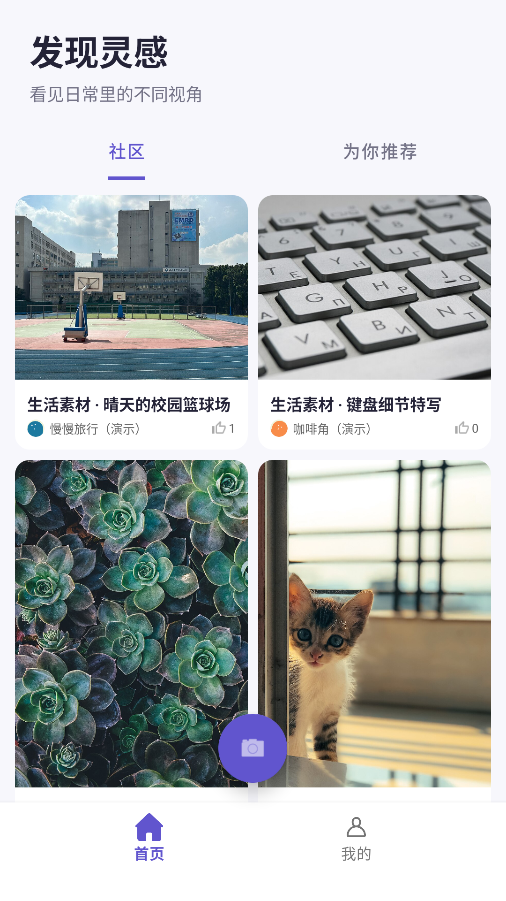
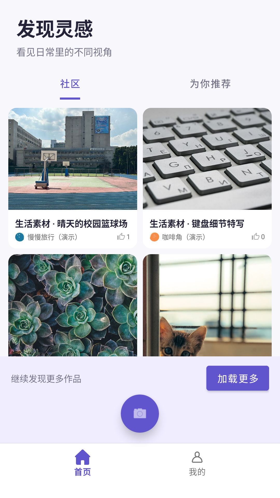
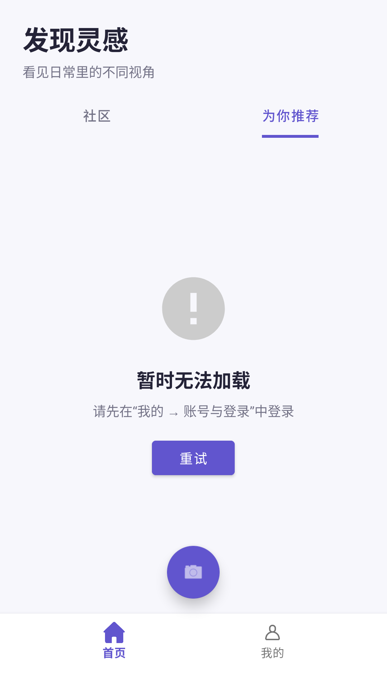

# F07 首页浏览体验与状态恢复

日期：2026-10-27。基于已上线的 `eb68c71` 继续完善 Android 首页。本轮代码和资料保留在本地，未提交、推送或再次部署服务端。

2026-10-29 当前交付：后续页面调整和游客交互已提交为 `bea72c5`；最终排版、32 项设备回归与当前截图见 [前端推送验收](前端推送验收-2026-10-29.md)。本文以下各日期截图和未提交状态保留为历史记录。

## 2026-10-28：移除常驻“加载更多”栏

- 按界面反馈移除正常浏览时的“加载更多”按钮、提示色块及 72dp 底部留白，作品列表直接延伸到底部导航上方。
- 保留滚动自动续页；首屏不足一屏时自动继续读取。仅在失败时显示无底色的文字与重试操作，到底时显示简洁提示。
- Debug APK 与测试 APK 构建通过，68 项 JVM 测试通过，首页 8 项设备回归通过，均无失败、无跳过。分页用例改为实际滚动触发，核对失败后保留作品并按原游标重试；直接跳转定位不会产生正向滚动位移，因此未用它代替滚动验证。
- 已安装最终 APK，经启动页进入首页读取云端社区内容，人工查看截图，常驻卡片栏已移除。代码仍未提交或推送。下文截图和 SHA-256 清单保留为 2026-10-27 的历史基线。



## 本轮实现

- 首页整理为「社区」「为你推荐」两个数据来源。移除原先实际都读取普通 Feed 的北京、团购、关注和搜索标签，保留推荐接口接线。
- 统一紫色主题、标题与说明、圆角作品卡片；空列表与请求失败分别展示不同标题、说明和按钮。
- 首次加载失败可重试；后续分页失败保留已有卡片和原游标，暂停自动续页，点击重试后继续原页。刷新失败保留已有卡片，重试仍从第一页开始。支持显式加载更多和末页提示。
- 页面退后台取消读取并复位加载状态，返回后重新核对；回调应用前检查账号/会话，发生变化时重新读取，避免沿用旧账号的点赞状态。
- 旋转重建保留当前社区/推荐标签；修正 MainActivity 首次启动重复创建 HomeFragment、重复发起读取的问题。
- 推荐接口返回 404 时明确提示暂不可用；游客看到登录说明。实际推荐内容仍依赖 Java 后端交付，本轮没有将普通 Feed 当作推荐结果。

## 验证结果

环境：JDK 17、Pixel 2 / API 36 模拟器。

- Android 编译、Debug APK 和设备测试 APK 构建成功。
- `:app:testDebugUnitTest`：**68 项通过，0 失败**。
- `:app:lintDebug`：**0 错误、280 条警告**，仍有项目级历史检查项待后续整理。
- 最终同一轮 `:app:connectedDebugAndroidTest`：**23 项通过，0 失败、0 跳过**，包括新首页 8 项、头像/推荐回归 11 项、个人资料回归 4 项。
- 首页专项覆盖首屏失败重试、分页失败保留卡片并复用游标、刷新失败后从首屏重试、后台恢复、请求中切换账号、旋转保留推荐来源、空态及推荐接口未上线。

复跑指令：

```powershell
.\gradlew.bat :app:testDebugUnitTest :app:assembleDebug :app:assembleDebugAndroidTest :app:lintDebug
.\gradlew.bat :app:connectedDebugAndroidTest '-Pandroid.testInstrumentationRunnerArguments.class=com.PixelFlow.app.API.HomeFeedFlowTest,com.PixelFlow.app.API.AvatarRecommendationFlowTest,com.PixelFlow.app.API.ProfileFlowTest'
```

测试时序也经过校正：冷启动期间等待 UI 空闲可能让受阻请求先触发 HTTP 超时。账号切换用例现先等待首屏就绪，再发起受控刷新，确认 MockWebServer 收到请求后直接切换同步会话，随后释放响应；不把请求已经结束后的切换当作并发验收。

最终设备结果：[JUnit XML](repros/F07-home-2026-10-27/device-tests.xml)；被验收文件：[SHA-256 清单](repros/F07-home-2026-10-27/source-sha256.json)。构建日志在本地 `frontend-home-build.log`、`frontend-home-final-verification.log`，不提交运行日志或 APK。

## 页面复核

安装最终 APK，通过实际启动入口打开应用，读取当前云端社区 Feed；未登录状态切换推荐，显示登录说明。两张截图已人工查看，卡片、文字、分页按钮及创作入口没有相互遮挡。





请求失败、分页重试和账号竞态用 MockWebServer 验证，不等于已验收推荐后端。本轮没有创建云端测试账号或作品，也没有执行后台审核。F07 两账号物理手机全链路仍待完成；头像和推荐后端、Issue 13/14 保留原分工。
