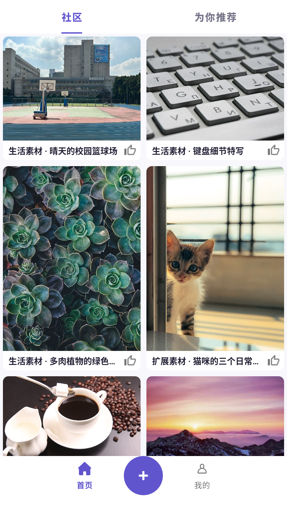

# 前端推送验收（2026-10-29）

按用户“将当前已经写好的代码推送到远程”的要求整理交付。先 fetch，再无冲突快进同步远程 master `944ec83`；未重置或丢弃本地修改。

前端代码提交：`bea72c5`（`feat(android): refine home feed layout and guest interactions`）。

## 本次内容

- 首页社区/推荐两个来源，移除大标题、副标题与常驻“加载更多”卡片；保留滚动续页、分页重试、刷新失败保留卡片、后台恢复及账号切换隔离。
- 保留当前工作区的后续排版：作品卡片显示单行标题与点赞入口，移除作者说明行；卡片使用 4dp 边距、8dp 圆角。与 10 月 28 日中间版本的直角贴边截图不同，本次截图为当前交付版本。
- “没有更多了”随列表末尾滚动；发布入口移入底部导航，滚动时不挡住图片。当前导航图标、文字没有重叠。
- 游客点击首页点赞或发布进入登录页；详情页不请求游客的关注状态，点赞/关注先引导登录。
- 同步首页设备回归、历史验收与部署记录。`api.properties` 的本地服务器地址、IDE 文件、日志、APK、凭据均不纳入提交。

## 验证

环境：Windows、Java 17、Pixel 2 / API 36 模拟器。

| 检查 | 结果 |
| --- | --- |
| Debug APK、设备测试 APK 构建 | 通过 |
| Android JVM 测试 | 68 通过，0 失败、0 错误、0 跳过 |
| 首页、头像/推荐、个人页、收藏详情设备回归 | 32 通过，0 失败、0 错误、0 跳过 |
| Android Lint | 0 错误、279 警告 |
| 同步后的迁移检查回归 | 21 通过 |
| 首页画面 | 安装最终 APK、从启动页进入并读取云端社区 Feed；已查看截图 |

构建命令：`gradlew.bat :app:assembleDebug :app:assembleDebugAndroidTest :app:testDebugUnitTest :app:lintDebug`。

设备命令：`gradlew.bat :app:connectedDebugAndroidTest -Pandroid.testInstrumentationRunnerArguments.class=com.PixelFlow.app.API.HomeFeedFlowTest,com.PixelFlow.app.API.AvatarRecommendationFlowTest,com.PixelFlow.app.API.ProfileFlowTest,com.PixelFlow.app.API.FavoriteDetailReviewTest`。

Python 命令：在 intelligence 目录设置 `PYTHONPATH=src`，以 Python 3.11 执行 `python -m pytest -q tests/test_verify_profile_pipeline.py`。

证据：[设备结果摘要](repros/F07-home-2026-10-29/device-tests.xml)、[被验收源码 SHA-256](repros/F07-home-2026-10-29/source-sha256.json)。摘要仅保留测试名称、耗时和计数，完整日志保留本地。

## 远程与部署边界

Issue 13、14 已在远程合入，两个 feature 分支已删除。Issue 14 的文件名/内容一致性修复为 `3f6b436`，本次回归通过。原 10 月 28 日 review 保留历史发现，并增加当前状态说明。

本次未运行完整 Java/MySQL 或真实画像链路，未核对 GitHub Actions 与云端实际发布版本；推送成功不等于自动部署成功。两账号物理手机全链路仍待完成。
