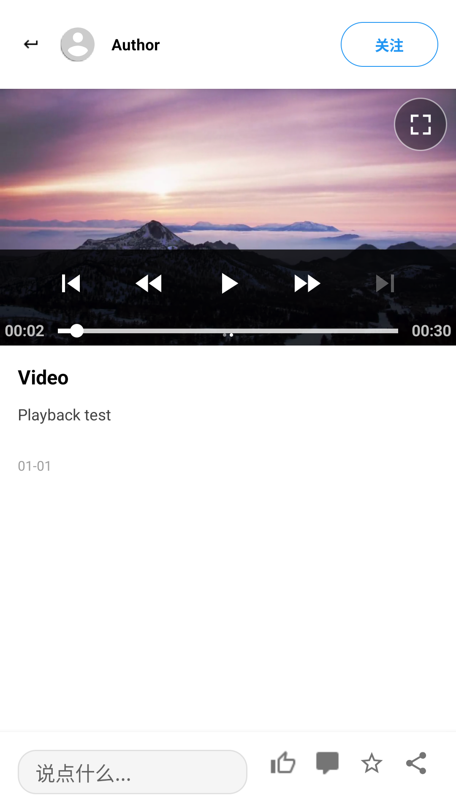

# 视频全屏与手势修复

## 2026-10-31：沉浸式全屏

按用户反馈，最新全屏播放器关闭原生控制栏，移除顶部返回按钮。播放时不显示进度条、时间或播放控制按钮；点击画面退出全屏，系统返回同样关闭全屏，继续保持原有播放进度和暂停状态。加载、失败重试及播放结束的重播提示仍按状态显示，详情内播放器控制不变。

Debug APK 和测试 APK 构建通过，13 项视频设备回归全部通过，Lint 为 0 errors / 277 warnings。测试在独立只读模拟器执行，未安装到实体手机。[本轮测试输出](repros/video-immersive-2026-10-31/instrumentation.txt)、[全屏截图](repros/video-immersive-2026-10-31/fullscreen.png)、[代码与 APK 摘要](repros/video-immersive-2026-10-31/tested-sha256.json)。

以下为此前修复记录，其中全屏控制栏和返回按钮的描述已由上述沉浸式交互替代。

问题：详情页点击视频无法像图片一样进入全屏，触摸后画面可能倾斜。本轮基于现有工作区增量修复，未覆盖其他同学的未提交修改。

## 确认的原因

1. 原详情页只给 `ImageViewHolder` 安装点击回调，`openFullScreenImage` 仅支持图片。视频只有播放/重试回调，已有的全屏视频 XML 没有被业务代码使用。
2. `WorkDetailActivity.onScroll` 未区分图片和视频，直接对 `imageContainer` 设置位移与 `deltaY * 0.005f` 的旋转。未处理的播放器触摸进入 Activity 后会触发这段逻辑，ACTION_CANCEL 也没有复位。模拟器测试以 120 px 拖动复现了约 0.6 度旋转。
3. 图片全屏使用完整 clips 列表的位置索引，却到过滤掉视频的 `getImageUrls()` 中取值。视频后的图片会打开错误图片或无法打开；延迟 80 ms 查找 ViewHolder 的绑定方式也存在时序依赖。

修复前两个针对性回归用例均失败，证据见 [before-fix.xml](repros/video-fullscreen/before-fix.xml)。

## 修复后的行为

- 点击视频画面或右上角全屏按钮，可进入独立全屏播放窗口；全屏使用 `fit` 保持视频比例，沿用详情页的竖屏方向，横向视频上下留黑，不强制旋转或裁切画面。
- 全屏与详情复用同一个 ExoPlayer，通过 [PlayerView.switchTargetView](https://github.com/google/ExoPlayer/blob/r2.16.1/library/ui/src/main/java/com/google/android/exoplayer2/ui/PlayerView.java) 切换显示目标。暂停状态、播放进度和音量保持，退出全屏回到原详情。
- 全屏保留播放、暂停、进度控制、失败重试和结束重播；系统返回键先关闭全屏窗口。
- 保存和恢复全屏状态；在后台缓冲完成不会自动起播，销毁详情时关闭全屏窗口并释放播放器。
- 页面拖动退出只接受图片区域内的手势；移除媒体旋转，小幅拖动/快速轻扫不会误退出，取消手势会复位。
- 视频触摸区明确区分点击、拖动和取消，拖动不会误打开全屏；点击经 `performClick()` 分发。
- 图片回调绑定实际 clip URL，修复图文混排索引问题，取消延迟查找 ViewHolder。

主要代码：`ImagePagerAdapter.java`、`WorkDetailActivity.java`、新增 `FullScreenVideoDialog.java`、`dialog_fullscreen_video.xml`、全屏按钮资源；设备用例在 `VideoPlaybackFlowTest.java`。

## 验证

使用本轮启动的只读 Pixel 2 / API 36 模拟器 `emulator-5556`；未安装或操作连接的实体手机。测试通过 MockWebServer 提供真实 H.264 MP4 和图片素材，不访问线上业务接口。

| 检查 | 结果 |
| --- | --- |
| 修复前针对性用例 | 2 项失败，确认无全屏和容器旋转 |
| 最终视频设备回归 | 13 项通过，0 失败 |
| Android JVM 用例 | 68 项通过，0 失败 |
| Debug APK / 测试 APK 构建 | 通过 |
| Android Lint | 0 errors，277 warnings，包含工作区已有告警 |
| 画面检查 | 实际解码帧正常；全屏窗口无倾斜、保持比例 |

新增设备回归覆盖点击全屏及返回后进度保持、原生暂停与进度控制、重建恢复全屏与暂停、后台缓冲、销毁释放、视频后的图片打开正确 URL、Activity 兜底手势不倾斜、播放器拖动/取消不触发全屏。原有封面定位、视频标识、页面切换、失败重试、重播和背景音乐联动用例继续通过。

一次中间测试的混排图片用例直接在 Activity 回调内打开 Dialog，导致 Espresso 选中尚未取得焦点的窗口。改成真实 UI 点击并等待窗口焦点后通过；此处没有改动生产逻辑以绕过断言。

最终 13 项设备测试的原始输出见 [final-instrumentation.txt](repros/video-fullscreen/final-instrumentation.txt)；[after-fix.xml](repros/video-fullscreen/after-fix.xml) 对应此前 12 项通过的运行。交付代码与 APK 摘要见 [tested-sha256.json](repros/video-fullscreen/tested-sha256.json)。

截图为模拟器测试素材：

| 详情内视频 | 全屏视频 |
| --- | --- |
|  |  |

安装本地新构建的 `app/build/outputs/apk/debug/app-debug.apk` 后才会在设备上生效。本轮未提交或推送 Git，也未部署服务器。
