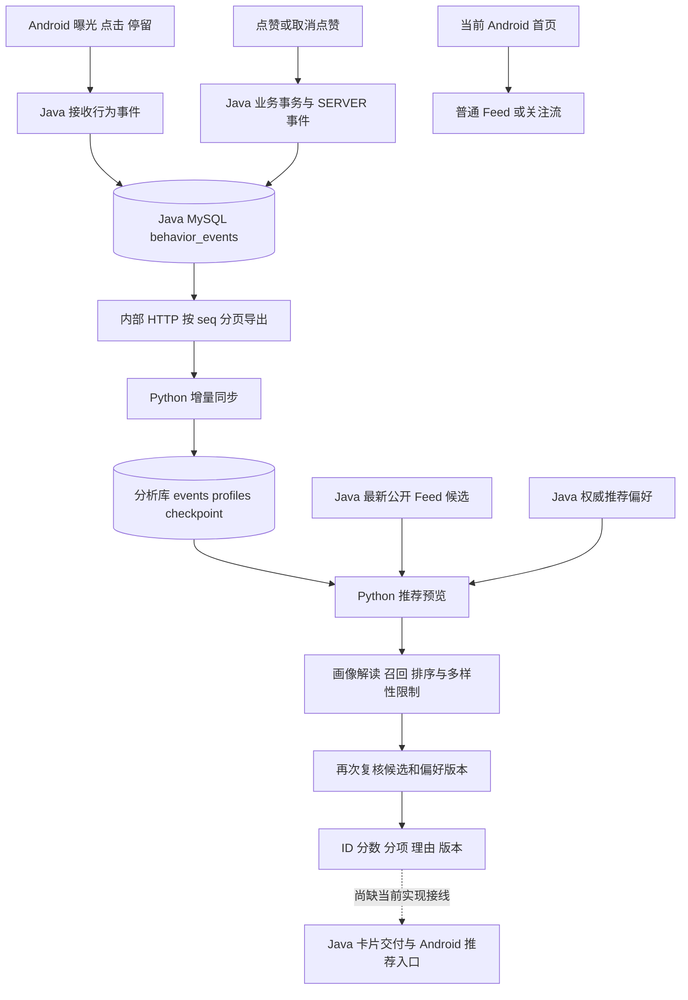

# 推荐技术与数据链路复盘

2026-11-11。依据当前源码及已获取的 origin/dev 快照。相关首页、分析、推荐和 Skill 源码在本轮比对中没有差异。本轮没有运行服务、重测或核验当前云端配置。

## 1. 首先区分能力与交付

**已经实现：行为采集、Java 事件持久化、Python 增量同步、规则画像与历史快照、规则推荐预览，以及显式推荐偏好。**

**当前核对版本的首页没有调用个性化推荐预览。** HomeFragment 调用 getFollowingFeed 或 getFeed；普通 Feed 的首屏刷新还执行 Collections.shuffle。Java /feed/ 按作品 ID 降序读取公开作品。Python 推荐分数没有参与此处排序。

任务文档描述过 `/api/recommendations/me/feed` 交付入口，但本次在当前及 origin/dev 的 Java/Android 实现中没有找到该路由的接线。不能把接口方案或旧验收描述当成当前首页实现。

因此，准确名称是“行为分析与可解释规则推荐预览”，暂不能声称“首页已根据用户行为完成实时个性化推荐”。之前讨论中把它直接描述成下一次首页内容选择，需要以本次源码核对为准。

## 2. 使用的技术

| 部分 | 技术与机制 | 作用 |
| --- | --- | --- |
| Android | RecyclerView 挂载回调、详情生命周期、HTTP 遥测 | 记录曝光、点击、停留 |
| Java | Spring Boot、JDBC、MySQL 事务 | 保存业务行为和偏好，维护权威作品状态 |
| 事件同步 | HTTP 分页、递增 seq、source_id、checkpoint、数据库锁 | 增量拉取、失败重试和来源校验 |
| Python | FastAPI、Pydantic、Python 规则计算、独立 MySQL 分析库 | 校验事件、计算画像、保存版本 |
| 推荐执行 | Skill Registry、类型化输入输出、scope、协作式期限 | 固定组合画像解读、召回、排序 |
| 推荐算法 | 标题关键词分类、加权偏好、热门候选补充、线性评分、多样性约束 | 产生有分项得分和理由的结果 |
| 调度 | 单轮维护 CLI、状态文件/互斥锁、systemd timer 模板 | 周期同步与画像重算 |

当前推荐没有训练模型、协同过滤、向量检索或大模型选内容；不依赖 MCP 执行推荐。Skill 的固定组合也不等于自主 Agent。

## 3. 两条已经存在的计算链与缺少的交付链



另有已实现的画像展示链：Android 调用 Java `/api/users/me/profile` 或 `/profile/history`，Java 代理 Python 本人当前/历史画像。能够展示画像，不代表首页已经消费推荐排序。

## 4. 行为采集

- 曝光：WaterfallAdapter.onViewAttachedToWindow 发出 EXPOSURE，当前适配器内用集合避免同作品重复记录。挂载近似曝光，不是达到某个可见面积/时长阈值的严格广告曝光定义。
- 点击：详情 onResume 首次满足条件时记录 CLICK。
- 停留：详情 onResume 记录单调时钟，onPause 计算时间；至少 1 秒、最多 30 分钟，检查账号与会话未变化再发送 DWELL。
- 点赞/取消：Java 在点赞业务状态真正变化时，在同一事务写 LIKE/UNLIKE，source=SERVER。重复设置相同状态不重复产生该事件。
- 不感兴趣：实际改变排除状态时更新偏好版本，启用时记录 NOT_INTERESTED。

Android trackEvent 当前仅允许 EXPOSURE/CLICK/DWELL。即使接口 schema 接受收藏、分享等类型，也不能据此说这些事件已全面采集、或已参与画像评分。

Java `/api/events` 从认证身份取得用户，检查作品、事件时间、停留字段以及 eventId。同一用户和 eventId 重复提交相同内容会去重，不同内容会冲突。

## 5. Java 到 Python 的增量链路

### 事件序列

EventWriter 在业务事务内锁定 event_export_state 单行，分配递增 seq 并写事件。导出端也协调该状态锁，防止并发事务分配顺序与提交可见顺序不一致，导致游标越过尚未提交的事件。

这种设计优先保障顺序与可靠性，但全局序列锁可能成为并发瓶颈，不能包装成高吞吐事件总线。

### HTTP 导出

Python 使用受控服务令牌请求 `/api/internal/analytics/events?after=游标&count=50`。响应包含 source_id、事件、next_cursor、has_more；Java 补充作品标题、作者、媒体类型和当前是否可用于分析的 eligible 标记。

### Python 单页事务

1. 锁定 checkpoint，读取上次游标。
2. 拉取一页，校验 schema、来源未变、seq 单调递增以及页尾游标。
3. 写入事件。
4. 对本页涉及用户读取已导入事件，重算画像并写入新版本。
5. 与事件一起提交新的 checkpoint；任一步失败则回滚。

“增量”指拉取新增事件。画像计算当前仍会重新读取该用户已导入事件再聚合，不是在线模型增量训练，也不是仅修改几个累加器。

## 6. 画像规则

分析窗口为最近 30 天，按 UTC 划分天和活跃小时。

| 信号 | 兴趣分规则 |
| --- | --- |
| CLICK | 同一作品每天最多计一次，1 分 |
| DWELL | 同一作品每天累计最多 120 秒，每 30 秒 1 分，最高 4 分 |
| SERVER LIKE/UNLIKE | 30 天窗口内按导入顺序保留作品最后一个点赞状态；最后为 LIKE 加 3 分，为 UNLIKE 不加 |
| EXPOSURE | 保留统计，不增加兴趣分 |
| 其他事件 | 可进入统计，但当前不参与这三个正向评分规则 |

只对 eligible 事件内容计入偏好。主题来自标题关键词表：美食、宠物、旅行、阅读、数码、运动、园艺；未命中为“其他”。多主题分摊该次行为权重，同时累计作者与图片/视频偏好。

示例：一天内对一篇只命中美食主题的作品点击一次、停留 60 秒并点赞，且窗口中该作品最后点赞状态仍是 LIKE，则贡献 1+2+3=6 分，分别进入主题、作者和媒体维度。它不是推荐概率或学习到的模型权重。

画像包含 version、rule_version、generated_at、window_days、cold_start、topics/authors/media、event_counts 和 active_hours。各偏好有 score/share；当前推荐用主题、作者、媒体偏好，不使用 active_hours 作为排序因子。

没有画像时返回 version=0 的冷启动结果；历史版本保留，不在每次查询时覆盖。

## 7. 推荐预览如何计算

入口为 Python `GET /recommendations/me/preview`。它携用户 access token 向 Java 确认身份，读取分析库画像和 Java 偏好。

### 7.1 候选和偏好

候选来自 Java 普通公开 Feed 的第一页，count=50，按当前 Feed 的 ID 降序规则取得，不是全库检索。每项含标题、作者、媒体类型、点赞数、创建时间和可见状态。

偏好包括 personalized、excluded_post_ids、blocked_author_ids、suppressed_topics、version。

- 作品排除和作者屏蔽合并为当前候选池的硬排除项。
- 关闭个性化则不把画像提供给后续 Skill。
- 主题抑制从当前用于推荐的画像副本中移除该主题，不改历史画像，也不硬性禁止该主题作品。

### 7.2 profile_insight

检查画像缺失、未来时间、过期、冷启动或无有效偏好；可用时归一化偏好，选择 personalized，否则选择 popular 并返回原因。默认画像有效期 24 小时。

### 7.3 candidate_recall

过滤非公开、作者不可用、显式排除、异常未来时间与冲突重复项。优先选兴趣匹配候选，再按点赞数、时间补充热门内容。

默认 limit=50，兴趣优先段最多 ceil(50/2)=25；剩余由热门列表去重补足。热门列表也可能含兴趣项，因此不能说严格一半兴趣、一半非兴趣。

由于输入池本身最多 50 条，默认召回上限也为 50，在有效候选未超额时，召回通常保留所有合规候选。此时兴趣优先段并不意味着最终数量配额，实际前十顺序主要由下一步排序决定。

### 7.4 feed_rank

```text
score = 4 × topic + 2 × author + media + popularity + freshness
popularity = min(1, log(1 + like_count) / log(1001))
freshness = 1 / (1 + age_days)
```

topic 为作品所命中主题的用户偏好占比均值；author 是该作者偏好占比；media 是相应图片/视频偏好占比。popular 模式把前三项置零。

热度取对数并封顶，降低大点赞数直接压倒其他分项的程度；新鲜度按创建时间递减。同分按创建时间、作品 ID 确定顺序。

默认输出最多 10 条，同作者最多 2 条、同主题最多 3 条；多主题作品占用每个主题配额。约束导致不足 10 条时允许少返回，不为填满而放宽。

输出包含每项分数、分项和规则生成的理由，以及画像/策略版本、trace_id、Skill 执行耗时。

### 7.5 输出前再次检查

再次读取公开候选和 Java 偏好。偏好版本变化则清空本次结果；候选消失或快照字段变化则丢弃对应项，不用未经复核的内容补位。

它提供快照复核，不是跨服务事务锁定。点赞数等变化也可能导致候选被丢弃，候选进入展示后仍需按业务接口重新鉴权。

## 8. 两条反馈路径与更新延迟

**隐式兴趣反馈**：点击、停留、点赞产生事件，经下一轮同步更新画像，再影响后续推荐预览。不是每一次行为后立即更新首页。

**显式偏好反馈**：不感兴趣、作者屏蔽、主题抑制、个性化开关直接保存在 Java；下一次推荐预览读取最新偏好，不必等待画像重算。

关闭个性化不意味着删除历史画像或停止采集。屏蔽作者在此处是推荐过滤，不是封禁作者或禁止访问其作品。

## 9. 调度状态

`maintenance` 每轮先同步事件，追完后才扫描需要刷新的画像；`scheduled_maintenance` 提供互斥、扫描游标和状态文件。systemd 模板配置开机约 2 分钟首次执行，此后在上次结束约 5 分钟后再执行。

模板存在不等于服务器已启用。11 月 7 日部署记录提到服务器未安装分析定时服务，本轮没有复核当前状态。应将“可周期执行的实现”和“已持续在线运行”分开。

## 10. 汇报可以讲什么

可以讲：

- 基于用户行为的可解释画像设计。
- 带游标和事务保障的跨服务分析链路。
- 通过三个 Skill 组合得到规则推荐预览。
- 偏好过滤、多样性和输出前状态复核。

不能讲：

- 当前首页已经完成用户行为到个性化排序的闭环。
- 推荐使用深度学习、向量库或大模型自动规划。
- 九组固定样例证明真实用户准确率、点击率提升。
- 云端保证每五分钟更新，或者已经实时推荐。

如保留第三条汇报主线，建议命名为“行为画像与推荐设计”。若要把它作为产品已完成的主能力，需要另外补齐并验收 Java 卡片交付和 Android 推荐入口。本次只梳理，没有实施接入。

## 源码与文档索引

- [首页实际数据入口](D:/desk/software_engineering/pixel-flow/app/src/main/java/com/PixelFlow/app/ButtonFragment/HomeFragment.java:435)
- [客户端遥测](D:/desk/software_engineering/pixel-flow/app/src/main/java/com/PixelFlow/app/API/CommunityClient.java:1060)
- [Java 事件接收](D:/desk/software_engineering/pixel-flow/server/src/main/java/com/pixelflow/server/events/EventController.java)
- [事件序列写入](D:/desk/software_engineering/pixel-flow/server/src/main/java/com/pixelflow/server/events/EventWriter.java)
- [事件增量导出](D:/desk/software_engineering/pixel-flow/server/src/main/java/com/pixelflow/server/events/AnalyticsExportController.java)
- [业务互动与服务端事件](D:/desk/software_engineering/pixel-flow/server/src/main/java/com/pixelflow/server/interaction/InteractionController.java)
- [分析库同步和画像版本](D:/desk/software_engineering/pixel-flow/intelligence/src/pixelflow_intelligence/analytics/store.py:112)
- [画像评分规则](D:/desk/software_engineering/pixel-flow/intelligence/src/pixelflow_intelligence/analytics/profile.py)
- [推荐预览编排](D:/desk/software_engineering/pixel-flow/intelligence/src/pixelflow_intelligence/recommendation/preview.py)
- [画像解读](D:/desk/software_engineering/pixel-flow/intelligence/src/pixelflow_intelligence/skills/profile_insight/__init__.py)
- [候选召回](D:/desk/software_engineering/pixel-flow/intelligence/src/pixelflow_intelligence/skills/candidate_recall/__init__.py)
- [排序与多样性](D:/desk/software_engineering/pixel-flow/intelligence/src/pixelflow_intelligence/skills/feed_rank/__init__.py)
- [分项定义](D:/desk/software_engineering/pixel-flow/intelligence/src/pixelflow_intelligence/skills/common.py)
- [推荐交付任务方案](D:/desk/software_engineering/pixel-flow/docs/issues/15-java-推荐交付入口.md)
- [调度说明](D:/desk/software_engineering/pixel-flow/deploy/分析调度使用说明.md)
- [线上流式部署记录中的调度边界](D:/desk/software_engineering/pixel-flow/docs/testing/issue27/服务器流式部署验收-20261107.md:55)
- [规则离线评测口径](D:/desk/software_engineering/pixel-flow/intelligence/src/pixelflow_intelligence/evaluation/README.md)
